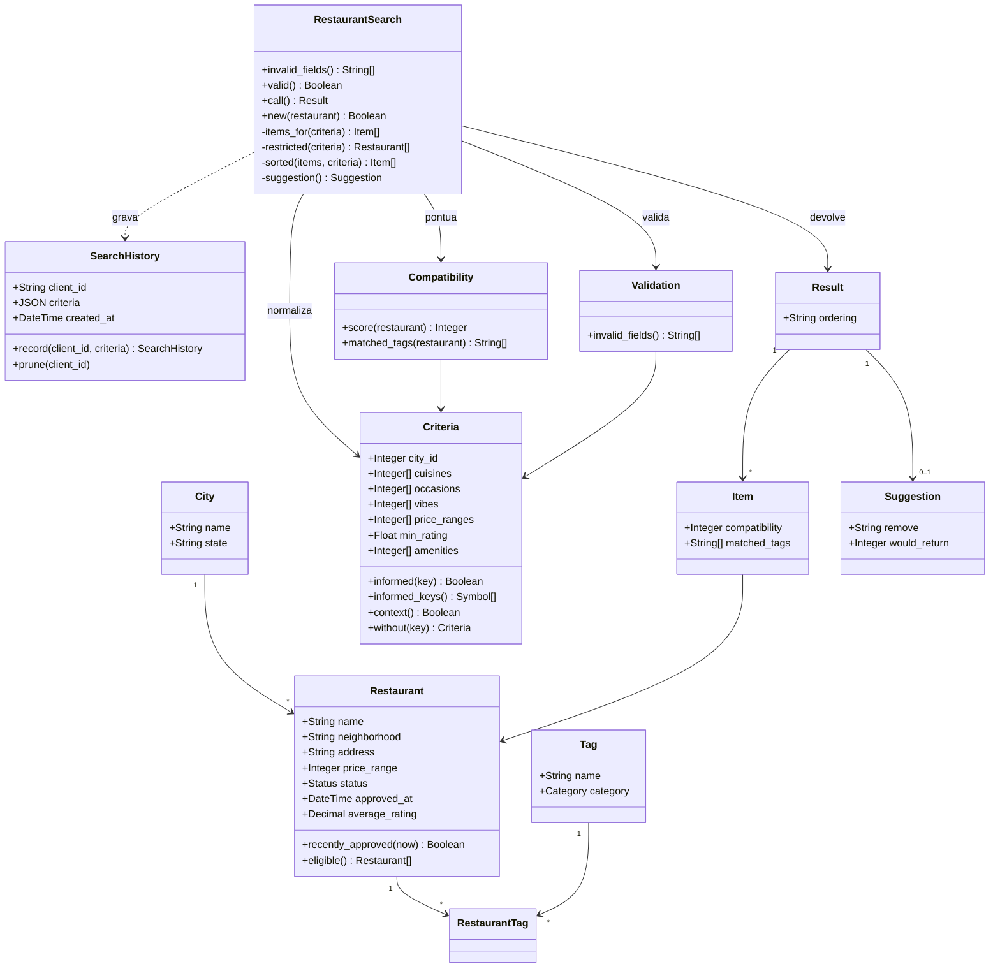

# Diagrama de classes — UC-C04 Buscar restaurantes por contexto

Alinhado ao modelo de dados (`db/schema.rb`) e ao serviço de busca
(`app/services/restaurant_search.rb`). Copie este arquivo para o repositório
de documentação, em `04-diagramas-de-classe/`.

## Entidades e serviço

## Enumerações

| Classe | Enumeração | Valores |
| --- | --- | --- |
| `Restaurant` | `status` | `pending`, `approved`, `rejected` |
| `Tag` | `category` | `cuisine`, `occasion`, `vibe`, `amenity` |
| `Result` | `ordering` | `compatibility`, `rating` |

## Onde cada regra vive

| Regra | Classe e método |
| --- | --- |
| RN-C01 Ignorar critérios não informados | `Criteria.from_params`, `Criteria#informed?` |
| RN-E05 Base elegível | `Restaurant.eligible` |
| RN-C02 Compatibilidade e ordenação | `Compatibility#score`, `RestaurantSearch#sorted` |
| RF23 Selo "Novidade" | `Restaurant#recently_approved?` |
| Fluxo 5c Sugerir critério a remover | `RestaurantSearch#suggestion` |
| RN-C09 Histórico de buscas | `SearchHistory.record` |
| Parâmetro inválido (422) | `Validation#invalid_fields` |

## Simplificação registrada

O grupo decidiu fazer a busca só por filtros, sem API de mapas e sem
geolocalização. Por isso o diagrama não tem o ator secundário de mapas nem
distância: o fluxo 1c (região não reconhecida) não ocorre, e a ordenação do
fluxo 1a usa apenas a nota.
